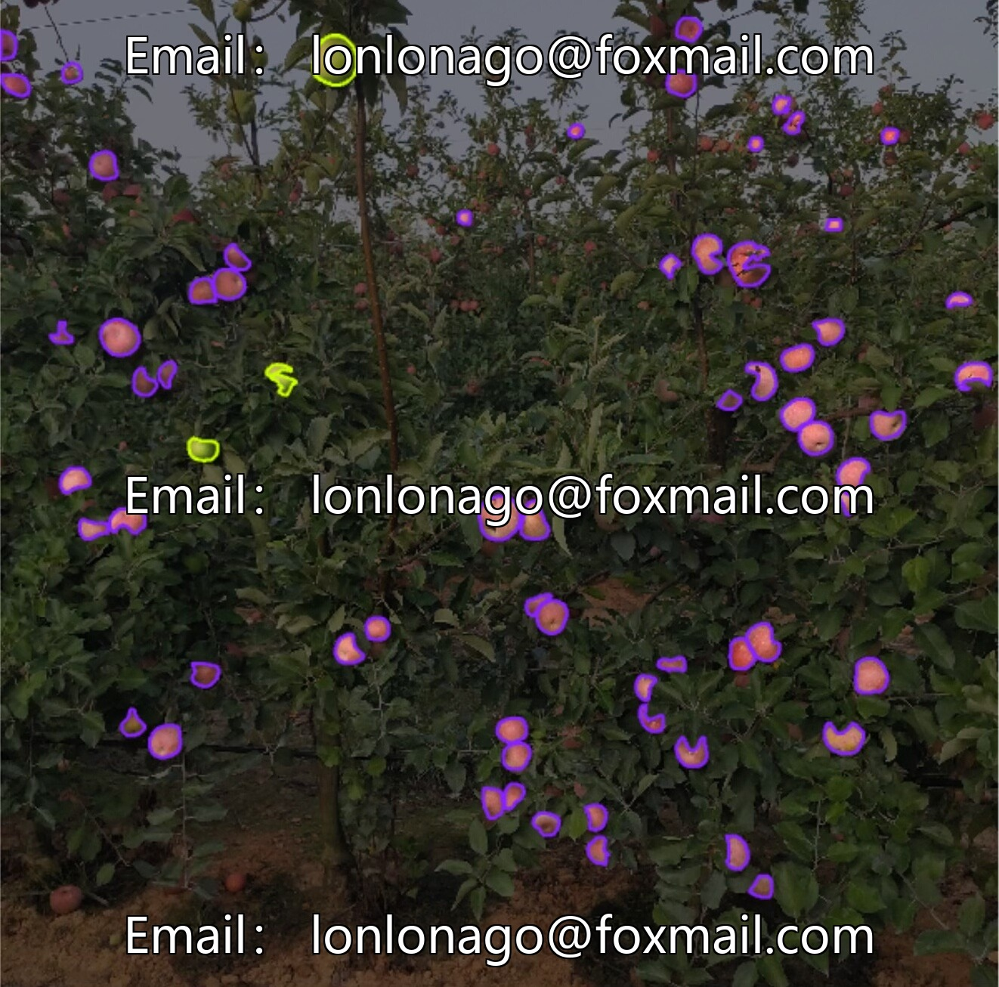
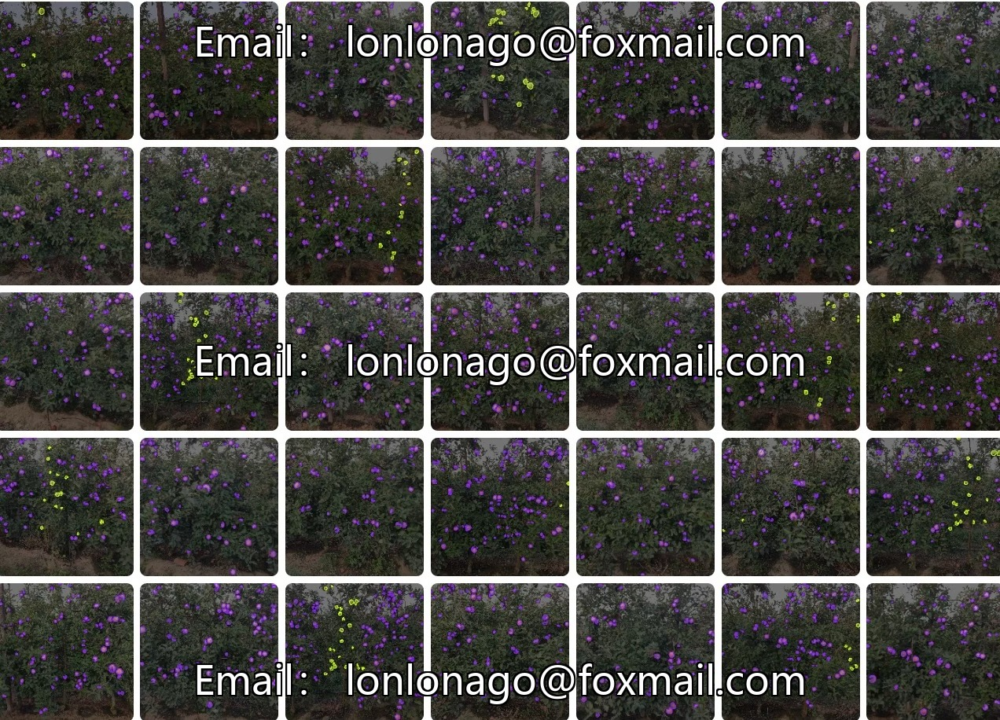
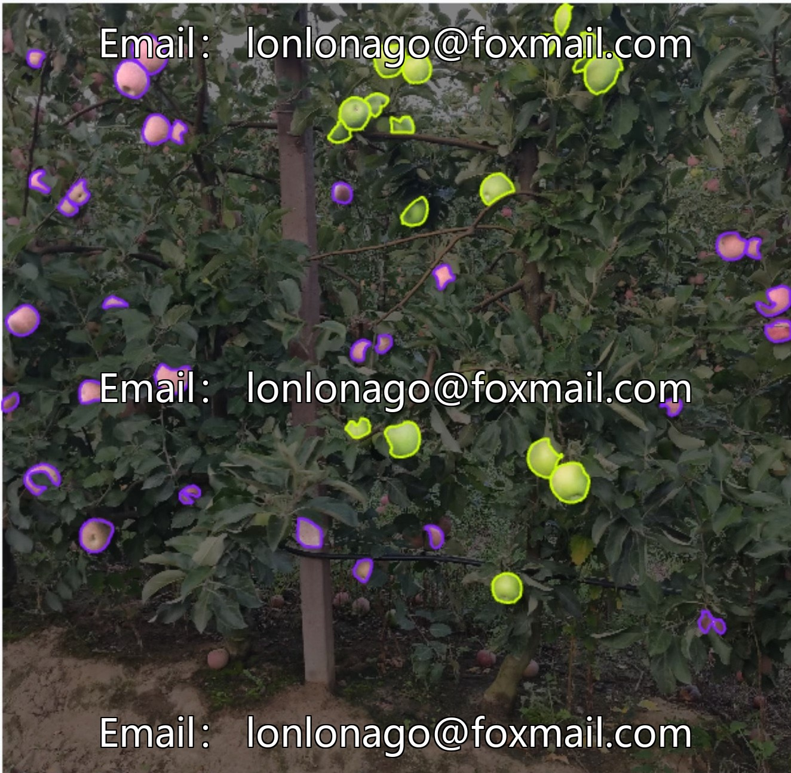
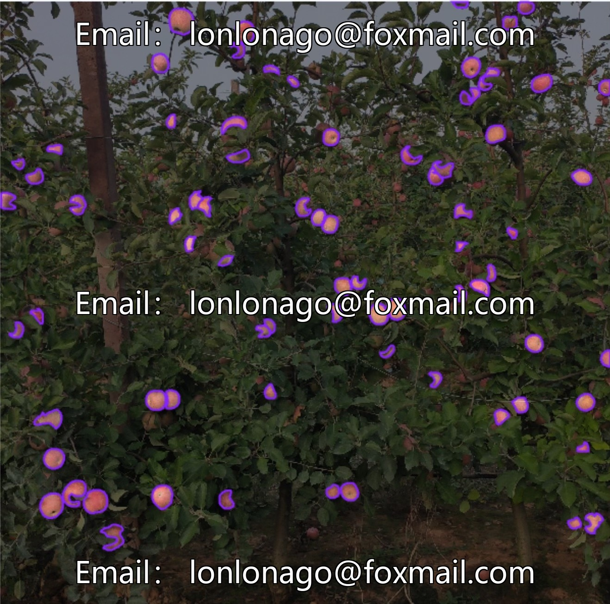
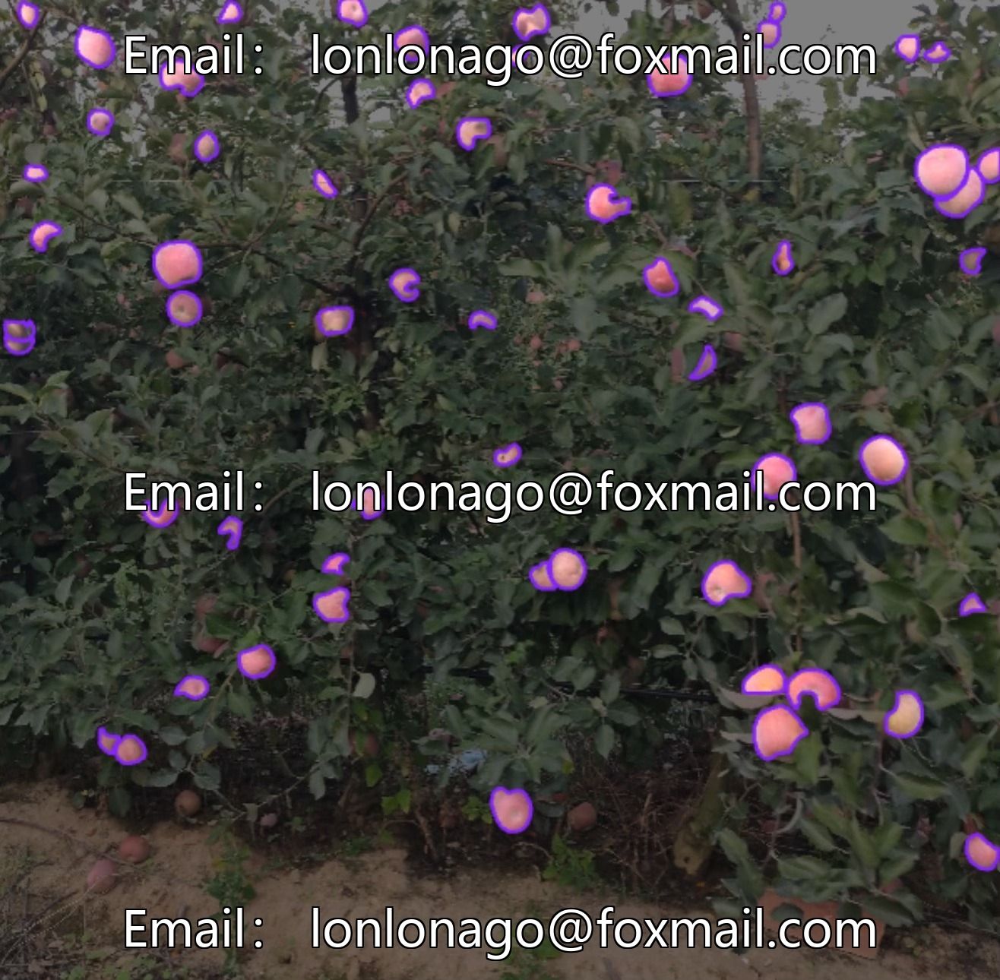

# Intelligent Agriculture Fruit Picking Point Identification Dataset - Apple Example Segmentation Dataset

## Body

Intelligent Agriculture Fruit Picking Point Identification Dataset - Apple Example Segmentation Dataset
Volume 10270, 342 images, supports segmentation of green apples (Green_Apple) and red apples (Red_Apple), suitable for scenarios such as automatic determination of apple maturity, intelligent statistics of orchard yield, and automation of agricultural product sorting. The dataset format is universal, and mainstream models can be directly used.

Virtual materials, once sold, are non-refundable.
Interested friends, click "I want" to proceed.

## Images

## Payment

Here is a pay link on Stripe ( https://buy.stripe.com/3cs8yP7sY87d0vu9AB ). Please contact me lonlonago@foxmail.com after funding $89, and I will send you a complete data files , thank you!

